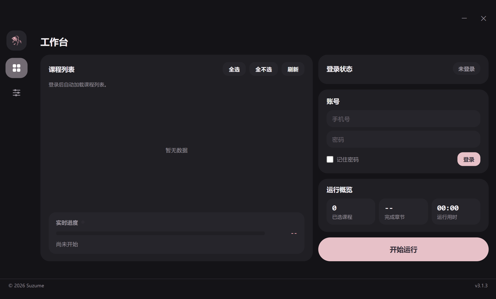

# CXHelper

超星学习通网课刷课助手

**下载**：[CXHelper-Setup.exe](https://suzume.cloud/downloads/CXHelper-Setup.exe) · 项目页：[suzume.cloud/projects/cxhelper](https://suzume.cloud/projects/cxhelper)

## 使用文档

一个帮助你节约时间的超星学习通刷课程序

首次使用需要用手机号和密码登录（不支持扫码），登录后会自动保存cookies下次自动登录

切换账号需要先停止运行再退出登录，登录不同账号后课程列表会自动刷新，确认勾选后再进行刷课

由于倍速过快可能更容易触发验证码，一般情况下不建议修改视频倍速（默认1倍，最高2倍，改完需要保存设置）

刷课过程中遇到验证码程序会自动尝试识别，识别失败的任务会被跳过，结束后再点一次「开始运行」会跳过已完成的继续刷

章节检测默认直接跳过不作答，需要答题的话要在设置里自己填题库，答案默认只保存不提交

需要闯关解锁的课程（做完上一章的章节检测才开放下一章）要填题库并打开自动提交，否则后面的章节会一直不开放

闯关课程每次只会刷到当时已经开放的章节，跑完后再点一次「开始运行」接着刷

打开自动提交后题库搜到的题达到最低题库覆盖率（默认0.9）才会提交，没搜到的题会随机作答或留空不保证正确率，没达到就只保存不提交

显示全部完成不代表章节检测已经提交，跑完后去学习通核对一下

点「停止」会等当前任务做完才停下，再点一次「强制停止」则立即中断

程序文件夹里的cookies.txt和日志带有登录信息，不要发给别人

## 从源码构建

需要 Python 3.13、Inno Setup 6，步骤见 [BUILD-RELEASE.md](BUILD-RELEASE.md)

## 许可

刷课核心基于 [Samueli924/chaoxing](https://github.com/Samueli924/chaoxing)，GPL-3.0，见 [LICENSE](LICENSE)
